## `$ ls ~/projects`

  
  
  
  

## `$ curl pt-ai-blockers/api/summary`

Live numbers from [PT AI Blockers](https://pt-ai-blockers.ricardofixe.workers.dev), refreshed every morning by a Cloudflare Worker:

## `$ cat now.txt`

- **Writing my thesis** on a multi-agent LLM system that plans how to learn any skill and adapts the plan to the learner.
